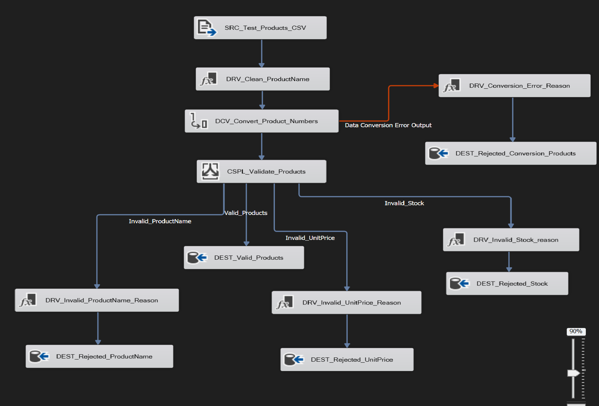
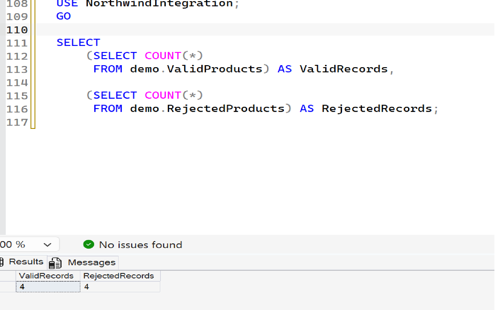

# Northwind Data Integration & ETL Automation

**Technologies:** Microsoft SQL Server | SSMS | SSIS | T-SQL | Visual Studio 2022

## 1. Project Overview

This independent portfolio project demonstrates the integration, cleansing and validation of relational business data using SQL Server Integration Services (SSIS) and T-SQL.

The project uses Microsoft's Northwind sample database to simulate an enterprise data integration workflow involving customers, products, suppliers, orders and shipping information.

An additional simulated product CSV dataset is used to demonstrate cleansing and rejection handling directly in SSIS.

## 2. Business Problem

Business information is stored across multiple related tables. To support reliable analysis and reporting, this information needs to be integrated, validated and standardized.

The project addresses the following requirements:

- Extract and transport data between SQL Server databases.
- Organize incoming data into staging and cleaned layers.
- Identify missing values, duplicates and invalid relationships.
- Apply defined transformation and validation rules.
- Separate valid and rejected records.
- Execute multiple SSIS packages through a Master Package.
- Test repeatable data loading.

## 3. ETL Architecture

The main integration workflow is:

**Northwind Source Database → SSIS → Staging Tables → SSIS/T-SQL → Cleaned Tables**

An SSIS Master Package coordinates execution of the individual ETL packages.

The data integration solution covers seven tables:

| Table | Records |
|---|---:|
| Shippers | 3 |
| Categories | 8 |
| Suppliers | 29 |
| Products | 77 |
| Customers | 91 |
| Orders | 830 |
| OrderDetails | 2,155 |
| **Total** | **3,193** |

## 4. SSIS Package Development

Developed and tested:

- 7 source-to-staging SSIS packages.
- 7 staging-to-cleaned SSIS packages.
- 1 Master Package to coordinate the complete workflow.

Used T-SQL stored procedures for cleansing, data updates, inserting new records and transaction handling.

Validated the integration process through record-count checks, data quality queries and repeated successful executions.

## 5. SSIS Data Cleansing Demonstration

Created a separate SSIS package:

`15_Clean_Products_SSIS.dtsx`

This package processes a simulated warehouse product CSV file containing intentional data quality problems.

### SSIS Transformations

- **Flat File Source:** Read the incoming CSV file.
- **Derived Column:** Remove unwanted whitespace.
- **Data Conversion:** Convert numeric and Unicode data types.
- **Conditional Split:** Validate product names, prices and stock quantities.
- **Error Output:** Redirect failed conversions.
- **OLE DB Destination:** Store valid and rejected records separately.

### Validation Results

| Test | Result |
|---|---:|
| Source records | 8 |
| Valid records | 4 |
| Rejected records | 4 |
| Duplicate ProductIDs in verified load | 0 |

Repeated successful full-refresh executions produced consistent record counts.

## 6. Documentation

- [Source-to-Target Mapping](docs/01_source_to_target_mapping.md)
- [SSIS Data Cleansing and Validation](docs/02_ssis_data_cleansing.md)

## 7. Skills Demonstrated

- SQL Server database integration
- SSIS Control Flow and Data Flow development
- Source-to-target mapping
- T-SQL stored procedures
- Data cleansing and standardization
- Business-rule validation
- Error redirection and rejected-record handling
- Data quality assurance
- SSIS Master Package orchestration
- Repeatable full-refresh ETL testing

## 8. Project Scope

The Northwind database is a sample dataset. The additional product cleansing dataset is simulated.

The demonstrated full-refresh approach is suitable for this portfolio exercise; production-grade failure recovery, unattended scheduling and operational monitoring are separate considerations.
