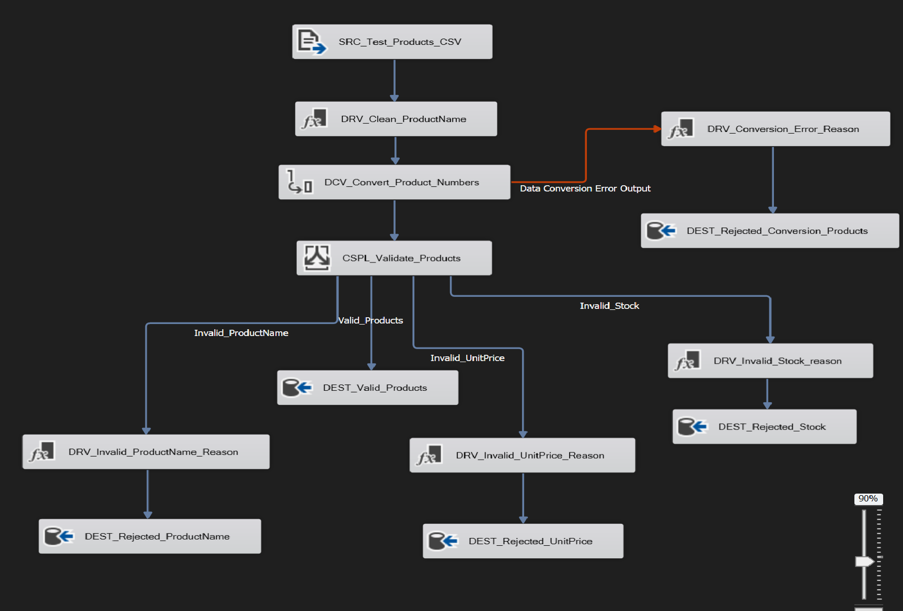
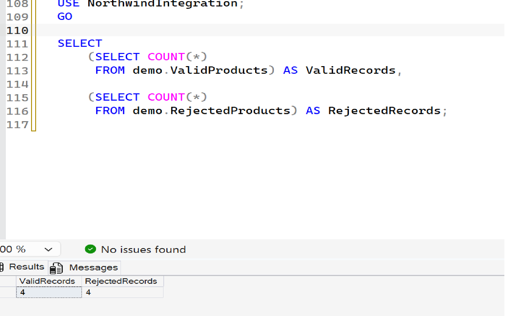
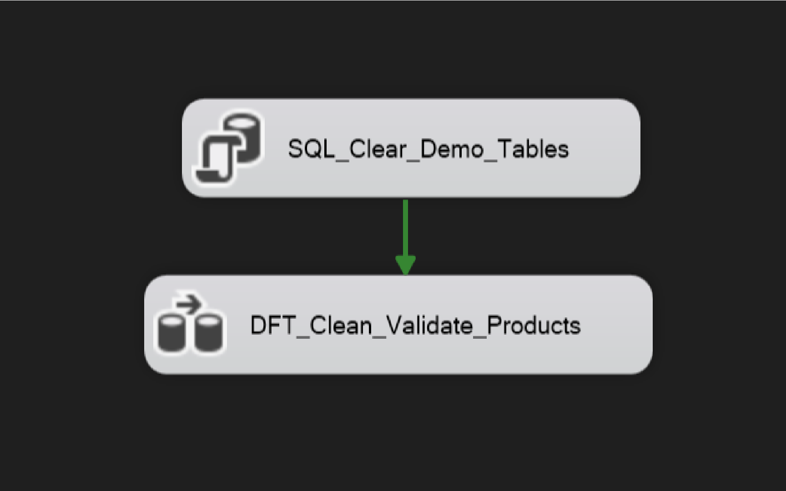


# SSIS Data Cleansing and Validation

## 1. Business Problem

A simulated warehouse receives product data from CSV files.

Incoming records may contain:
- Unwanted spaces in product names
- Missing product names
- Invalid numeric values
- Negative prices
- Negative stock quantities

The objective is to clean the data, apply business
validation rules, and separate valid records
from rejected records.

## 2. Technologies Used

- SQL Server
- SQL Server Integration Services (SSIS)
- Visual Studio 2022
- T-SQL
- CSV files

## 3. SSIS Package

Package: 15_Clean_Products_SSIS.dtsx

### Data Flow

1. Flat File Source: Read the product CSV.
2. Derived Column: Clean product names using
   TRIM and REPLACE.
3. Data Conversion: Convert text values into
   numeric and Unicode data types.
4. Conditional Split: Apply business rules.
5. Error Output: Redirect conversion errors.
6. OLE DB Destination: Load valid and
   rejected records into separate SQL tables.

## 4. Business Rules

| Rule | Action |
|---|---|
| Extra spaces in ProductName | Remove unwanted spaces |
| Missing ProductName | Reject |
| Invalid numeric conversion | Reject and capture error |
| Missing or negative UnitPrice | Reject |
| Missing or negative UnitsInStock | Reject |
| Valid records | Load into demo.ValidProducts |
| Invalid records | Load into demo.RejectedProducts |

## 5. Validation Results

Eight simulated records were processed.

| Validation | Result |
|---|---:|
| Total source records | 8 |
| Valid records | 4 |
| Rejected records | 4 |
| Duplicate ProductIDs after clean test | 0 |

Rejected ProductIDs: 103, 104, 105, 107.

## 6. Repeatable ETL Execution

An Execute SQL Task clears the demonstration
tables before each full-refresh load.

The Data Flow then reloads the CSV records.

Repeated successful executions produced:
- 4 valid records
- 4 rejected records

This demonstrates repeatability with unchanged
source data, but not failure-safe recovery.

## 7. Conclusion

This exercise demonstrates SSIS data cleansing,
numeric conversion, business-rule validation,
error redirection, rejected-record handling
and repeatable full-refresh loading.

The dataset is simulated and separate from
the original Northwind business tables.